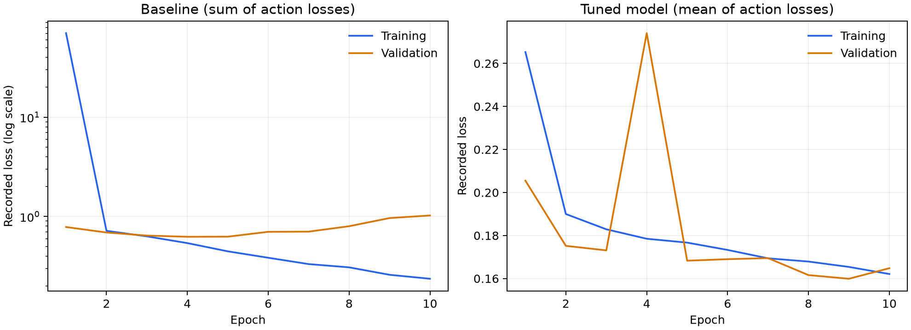
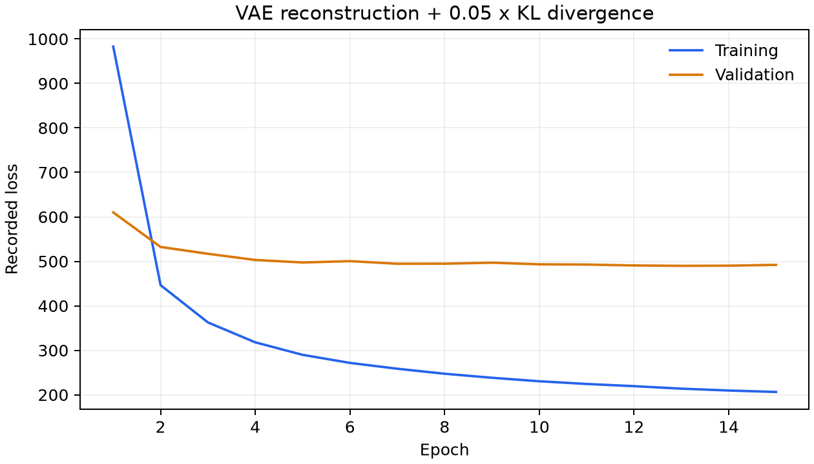

# Robotic Behaviour Cloning

Predict robot movement and gripper actions from paired camera views and robot state. This project compares an end-to-end supervised CNN with a frozen variational autoencoder (VAE) representation and an action-prediction head.

The full implementation is available in [behaviour_cloning.py](robotic-behaviour-cloning/behaviour_cloning.py).

## Overview

The pipeline includes:

- Loading and inspecting preprocessed robot demonstrations.
- Training a multimodal supervised baseline.
- Evaluating movement prediction and gripper classification.
- Training a larger CNN with augmentation, Dropout, and weight decay.
- Learning visual representations with a convolutional VAE.
- Training an action-prediction head on frozen VAE features.
- Comparing held-out predictions and model parameter counts.

Evaluation uses recorded demonstrations. Robot rollouts and physical task success rates are not measured.

## Dataset

The observations are associated with the [CLVR Jaco Play dataset](https://github.com/clvrai/clvr_jaco_play_dataset).

The implementation consumes preprocessed HDF5 files containing:

| Field | Content |
| --- | --- |
| `front_cam_ob` | Front camera grayscale images |
| `mount_cam_ob` | Robot-mounted camera grayscale images |
| `ee_cartesian_pos_ob` | 7 position and orientation features |
| `ee_cartesian_vel_ob` | 6 velocity features |
| `joint_pos_ob` | 2 joint and gripper features |
| `actions` | 3 movement targets and a gripper label |
| `terminals` | Episode-boundary indicators |

Images in the recorded data have a resolution of 224 × 224. The robot-state inputs form a 15-dimensional vector.

Recorded runs contain:

| Split | Samples |
| --- | ---: |
| Training | 25,469 |
| Validation | 2,901 |
| Test | 7,352 |

Datasets, exact split manifests, model checkpoints, and raw-to-HDF5 conversion are not included. Obtain permitted access through the dataset source and prepare compatible HDF5 splits before training.

The gripper value is used as an index into a three-column target. Its encoding and class semantics must be consistent across all splits.

## Methodology

### Supervised action prediction

The baseline combines two branches:

```text
Paired camera views → CNN → Image embedding
Robot state         → MLP → State embedding
                                ↓
                         Add embeddings
                                ↓
                         Action prediction
```

The baseline CNN uses convolution channels of 8, 16, and 32. The tuned model uses 16, 32, and 64, together with:

- Random resized crops.
- Brightness and contrast augmentation.
- Dropout with probability 0.3.
- Adam with weight decay of 1e-4.

Outputs contain three movement values and three gripper-class logits.

The tuned model minimizes:

```text
Action loss = 0.5 × movement MSE + 0.5 × gripper cross-entropy
```

The baseline sums the two task losses, so its reported loss scale differs.

### VAE representation learning

A convolutional VAE learns a 64-dimensional visual representation from the paired camera views.

Its objective is:

```text
VAE loss = reconstruction MSE + 0.05 × KL divergence
```

Reconstruction error is summed over pixels and averaged over each batch. The VAE is trained for 15 epochs.

For downstream action prediction, the encoder is frozen. Its latent mean is concatenated with an encoded robot-state vector, and a prediction head is trained for 10 epochs.

## Recorded Results

The following values come from saved historical execution output. They are not newly measured results from the standalone Python script, and exact numerical reproduction has not been established.

| Model | Action loss | Movement MSE | Gripper accuracy |
| --- | ---: | ---: | ---: |
| Tuned end-to-end CNN | 0.1656 | 0.0101 | 87.76% |
| Frozen VAE + prediction head | 128.5391 | 82.5828 | 32.37% |

The comparison has an important limitation: VAE pretraining and downstream prediction use different image scaling. These results therefore do not isolate the quality of the learned representation or establish that VAE pretraining is unsuitable for the task.

### Supervised training



### VAE training



Figures are generated from saved training text logs. Numeric measurements and their provenance are documented in [results/README.md](robotic-behaviour-cloning/results/README.md).

## Repository Structure

```text
.
├── README.md
└── robotic-behaviour-cloning/
    ├── behaviour_cloning.py
    ├── requirements.txt
    ├── .gitignore
    ├── figures/
    │   ├── supervised_training.png
    │   └── vae_training.png
    └── results/
        ├── README.md
        ├── training_history.csv
        └── test_metrics.csv
```

All model, data-processing, training, and evaluation code is contained in one Python file.

## Installation

From the repository root:

```bash
cd robotic-behaviour-cloning

python3 -m venv .venv
source .venv/bin/activate

python -m pip install -r requirements.txt
```

Full training requires a CUDA GPU because the baseline retains its half-precision configuration. Install a compatible CUDA-enabled PyTorch and torchvision pair.

Dependencies are listed directly; a complete historical environment lock is not available.

## Usage

Prepare the following directory inside `robotic-behaviour-cloning/`:

```text
data/
├── train/
│   ├── train_0.h5
│   └── ...
├── val/
│   ├── val_0.h5
│   └── ...
└── test/
    ├── test_0.h5
    └── ...
```

Each file must contain the aligned arrays described in the dataset section.

Run the full pipeline:

```bash
python behaviour_cloning.py \
    --data-dir data \
    --output-dir runs/latest
```

New analysis figures and test measurements are written to the output directory. No experiment-tracking account is required.

To regenerate figures from the recorded CSV measurements without training:

```bash
python behaviour_cloning.py --plot-recorded
```

To view command-line options:

```bash
python behaviour_cloning.py --help
```

Data are loaded into RAM, including additional float32 copies, so memory requirements can be substantial.

## Limitations

- Image scaling differs between VAE pretraining and downstream prediction, limiting conclusions about representation quality.
- The tuned prediction head is called twice per forward pass, producing separate Dropout masks during training.
- Final evaluation uses the in-memory models rather than restoring the best validation checkpoints.
- Test metrics average batch means rather than weighting each batch by its sample count.
- The image-summary helper assumes a channel-last layout and can misreport grayscale-array shapes.
- Reconstruction quality and parameter counts alone do not establish downstream usefulness or faster convergence.
- The standalone workflow has not been retrained end to end. Historical results remain separate from new runs.

## Technologies

Python · PyTorch · torchvision · NumPy · pandas · scikit-learn · Matplotlib · h5py · tqdm
