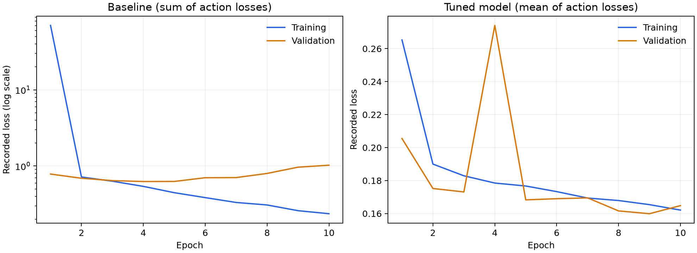
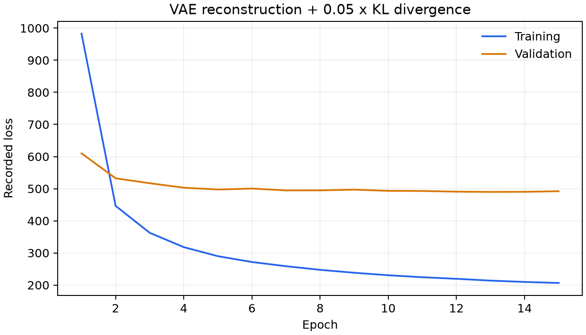

# Robotic Behaviour Cloning

Predict robot movement and gripper actions from two camera views and robot state. Compare an end-to-end CNN with a frozen convolutional VAE representation and an action-prediction head.

**All project code is in [`behaviour_cloning.py`](behaviour_cloning.py).** Read it from top to bottom: data helpers, models, evaluation, and the training workflow. There are no notebook cells or separate Python modules.

## What the code does

1. Loads preprocessed HDF5 training, validation, and test splits.
2. Inspects numeric distributions and input images.
3. Trains a supervised baseline using paired grayscale views and 15 robot-state features.
4. Evaluates movement error, gripper classification, and failure patterns.
5. Trains a larger CNN with augmentation, Dropout, and weight decay.
6. Trains a convolutional VAE with a 64-dimensional latent space.
7. Freezes the VAE encoder and trains a head on its latent mean and robot-state features.
8. Compares the prediction models on the test split and counts their parameters.

The baseline CNN uses channels 8, 16, and 32; the tuned CNN uses 16, 32, and 64. Image and state embeddings are added in the supervised models. The frozen-VAE model concatenates the latent mean with an encoded state vector.

The tuned model and frozen-VAE head minimize `0.5 * movement MSE + 0.5 * gripper cross-entropy`. The baseline retains a **sum** of the two losses, so its loss scale differs. VAE training uses per-sample summed reconstruction MSE plus `0.05 * KL divergence`.

## Data

Observations are associated with the [CLVR Jaco Play dataset](https://github.com/clvrai/clvr_jaco_play_dataset). The script requires a preprocessed representation with the following aligned arrays in each HDF5 file:

| Field | Expected content |
| --- | --- |
| `front_cam_ob`, `mount_cam_ob` | Grayscale arrays shaped `(N, 224, 224)`, with pixel values on a 0–255 scale |
| `ee_cartesian_pos_ob` | `(N, 7)` position/orientation features |
| `ee_cartesian_vel_ob` | `(N, 6)` velocity features |
| `joint_pos_ob` | `(N, 2)` joint/gripper features |
| `actions` | `(N, 4)`: movement X/Y/Z, then gripper label |
| `terminals` | `(N,)` episode-boundary indicator |

The retained collation code uses the gripper value as an index into a three-column target. Inputs must use integer labels in `{-1, 0, 1}` or `{0, 1, 2}`; `-1` indexes the last column. Match the original data encoding consistently across splits and verify class semantics before interpreting the printed class names.

Data, split manifests, checkpoints, and raw-to-HDF5 conversion are not bundled. Obtain permitted access through the dataset source and prepare compatible splits. Recorded runs contain 25,469 training samples, 2,901 validation samples, and 7,352 test samples; the exact historical split cannot be reconstructed from this repository alone.

```text
data/
├── train/
│   ├── train_0.h5
│   └── ...
├── val/
│   ├── val_0.h5
│   └── ...
└── test/
    ├── test_0.h5
    └── ...
```

## Run

Use a clean Python environment with a compatible CUDA-enabled PyTorch/torchvision pair:

```bash
python3 -m venv .venv
source .venv/bin/activate
python -m pip install -r requirements.txt
python behaviour_cloning.py --data-dir data --output-dir runs/latest
```

Full training requires a CUDA GPU because the baseline retains its half-precision configuration. Data are loaded into RAM, including additional float32 copies. The workflow runs the baseline, tuned CNN, VAE, frozen-encoder head, and test evaluation in order. New analysis figures and test measurements go to the output directory. No tracking account is required.

To regenerate the figures below from the recorded CSV files without training:

```bash
python behaviour_cloning.py --plot-recorded
```

## Recorded results

These are saved historical measurements, **not new results from the single-file script**. The model definitions and training choices are retained, while data-loading and baseline-training support are implemented locally. Exact numerical reproduction has not been established.

| Model | Action loss | Movement MSE | Gripper accuracy |
| --- | ---: | ---: | ---: |
| Tuned end-to-end | 0.1656 | 0.0101 | 87.76% |
| Frozen VAE + head | 128.5391 | 82.5828 | 32.37% |





The curves are generated from saved training text logs. Separate experiment curves whose measurement provenance could not be established are excluded. Numeric records are in [`results/`](results/README.md).

## Interpretation and limitations

- VAE pretraining scales pixels by 255, but downstream training reuses the tuned float-array transforms without that scaling. This input mismatch limits conclusions about representation quality.
- The tuned prediction head is called twice in a forward pass, retaining different Dropout masks during training. This behavior has not been silently changed.
- Test evaluation uses final in-memory weights and averages batch means; it does not restore the best validation checkpoint.
- The image-summary helper assumes a channel-last layout and can misreport grayscale image shapes. The failure analysis labels the target movement Z component, rather than treating it as scene depth.
- Reconstruction examples do not establish downstream usefulness. Parameter counts do not establish faster convergence.
- Evaluation is offline action prediction. There are no robot rollouts or measured physical task success rates.
- The complete workflow has not been retrained. Dependencies are a direct list, not a historical environment lock.

## Files

```text
robotic-behaviour-cloning/
├── behaviour_cloning.py
├── README.md
├── requirements.txt
├── .gitignore
├── figures/
│   ├── supervised_training.png
│   └── vae_training.png
└── results/
    ├── README.md
    ├── training_history.csv
    └── test_metrics.csv
```

Python, PyTorch, torchvision, NumPy, pandas, scikit-learn, Matplotlib, h5py, and tqdm are used. No external project-specific helper package is required.
